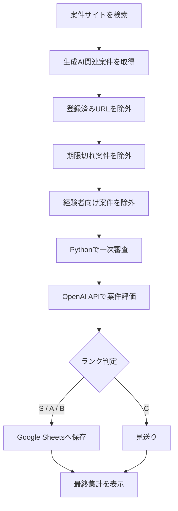

# AI Job Agent

生成AI関連の案件を自動で検索・評価し、条件の良い案件だけをGoogle Sheetsへ保存するAIエージェントです。

## 主な機能

- Lancers Tech Agentから案件を検索
- CrowdWorksから案件を検索
- ChatGPT / 生成AI / Claude / Gemini / Canva AI など複数キーワードに対応
- 募集期限切れ案件を自動除外
- URL重複を自動除外
- 類似タイトルの重複案件を自動除外
- 経験者向け案件を自動除外
- Pythonによる一次審査
- OpenAI APIによる案件評価
- S / A / B / C の4段階で自動ランク付け
- Bランク以上だけGoogle Sheetsへ保存
- 報酬・必要スキル・おすすめ度などを自動整理
- 通信エラー時の自動リトライ

## 処理の流れ

1. 求人サイトから生成AI関連案件を検索
2. 登録済みURLを除外
3. 期限切れ案件を除外
4. 初心者向けかPythonで一次審査
5. OpenAI APIで案件内容を評価
6. ランクを決定
7. 条件を満たした案件だけGoogle Sheetsへ保存

## 使用技術

- Python
- OpenAI API
- Google Sheets API
- gspread
- BeautifulSoup
- requests
- Playwright

## 評価項目

AIが以下の項目を評価します。

- 初心者向け度
- おすすめ度
- 必要スキル
- 勉強すべきこと
- 案件メモ
- 総合スコア
- 応募優先度

## ランク基準

- S：9点以上
- A：7点以上
- B：5点以上
- C：4点以下

現在はBランク以上の案件のみGoogle Sheetsへ保存します。

## 注意

APIキーやGoogleサービスアカウント情報は公開リポジトリへアップロードしないでください。

## セットアップ

### 1. 必要なライブラリをインストール

```bash
pip install openai gspread google-auth beautifulsoup4 requests playwright
playwright install chromium
```

### 2. 環境変数を設定

以下の3つを設定してください。

```bash
export OPENAI_API_KEY="your_openai_api_key"
export AI_JOB_SPREADSHEET_ID="your_google_spreadsheet_id"
export GOOGLE_SERVICE_ACCOUNT_FILE="/path/to/service-account.json"
```

`.env.example` も参考にできます。

### 3. Google Sheetsを準備

Googleサービスアカウントを作成し、対象のGoogle Sheetsをサービスアカウントのメールアドレスと共有してください。

### 4. エージェントを実行

```bash
python3 ai_job_agent.py
```

実行すると、案件検索・重複除外・一次審査・AI評価・Google Sheetsへの保存まで自動で行います。

## セキュリティ

以下の情報はGitHubなどの公開リポジトリへアップロードしないでください。

- OpenAI APIキー
- GoogleサービスアカウントJSON
- 個人用Google Sheets ID
- `.env` ファイル

このプロジェクトでは `.gitignore` を使用して、秘密情報の誤公開を防ぎます。

## 実行結果の例

実行すると、案件の検索・重複除外・一次審査・AI評価・保存結果をターミナルで確認できます。

```text
AI案件調査 完了
====================================
検索で見つけた件数： 224
新規候補： 138
追加した件数： 1
エラー： 0
AI評価した件数： 20
Cランク見送り： 19
タイトル重複で除外： 0
経験者タイトルで除外： 0
Aランク： 0
Sランク： 0
====================================
```

## 処理フロー



## Google Sheetsへ保存する情報

| 項目 | 内容 |
|---|---|
| 案件名 | 募集タイトル |
| サイト | CrowdWorks / Lancers |
| 仕事内容 | 案件本文 |
| 報酬 | 抽出した報酬情報 |
| 必要スキル | AIが要約 |
| 初心者向け度 | 5段階評価 |
| おすすめ度 | 5段階評価 |
| リモート | 在宅可否 |
| 応募URL | 案件ページ |
| 募集期限 | 応募締切 |
| 勉強すべきこと | 応募前に学ぶ内容 |
| 総合点 | AI評価スコア |
| 応募優先度 | S / A / B / C |

## このプロジェクトで工夫した点

- 同じURLの案件を重複登録しない
- タイトルがほぼ同じ再投稿案件も除外
- 期限切れ案件を自動除外
- 経験者向け案件を一次審査で除外
- AI APIを使う前にPythonで絞り込み、API利用量を抑える
- 通信エラー時は最大3回まで自動リトライ
- APIキーやGoogle認証情報を環境変数で管理
